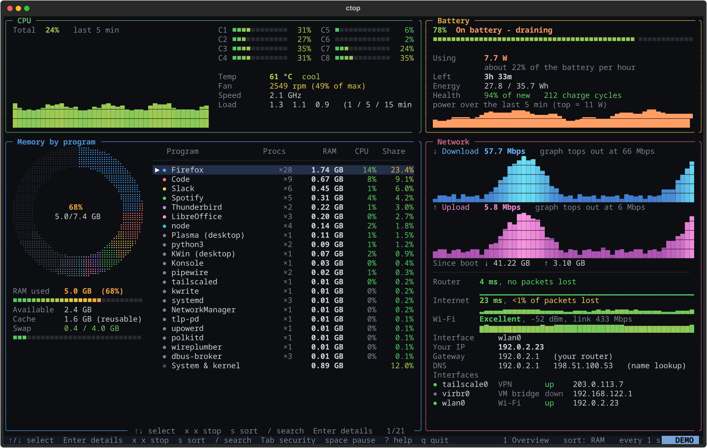
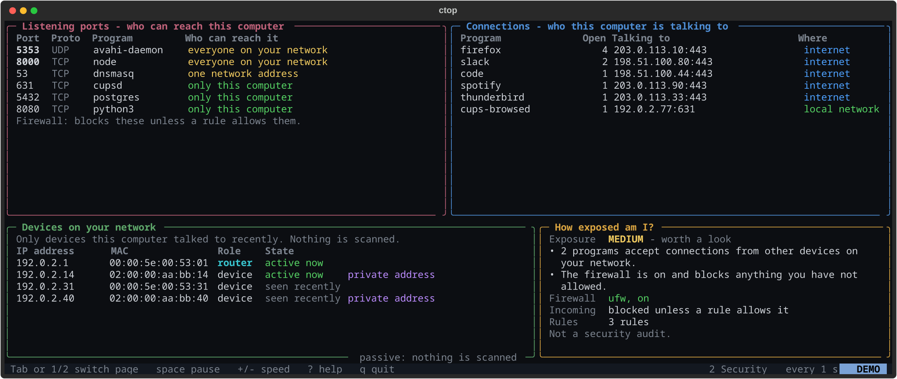
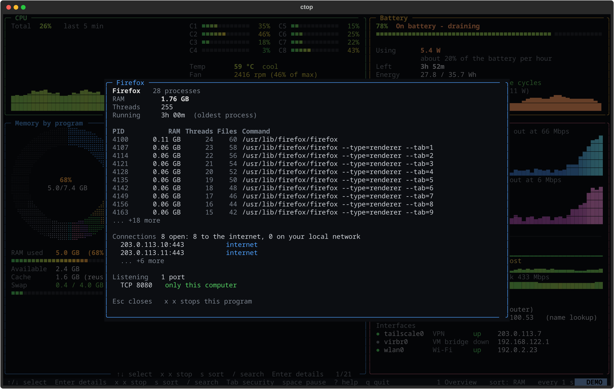
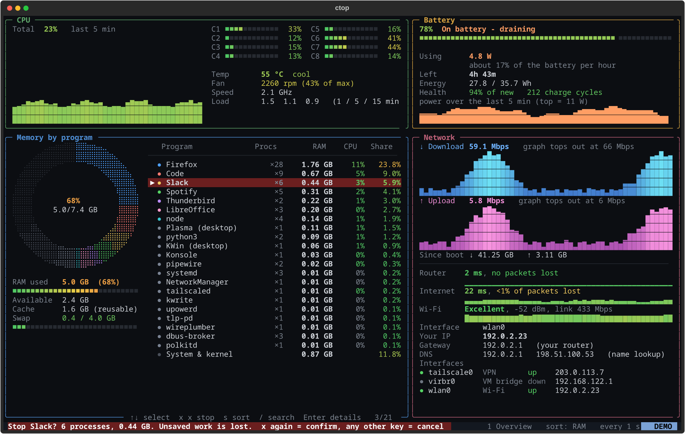

# ctop

**A btop-style terminal dashboard that gives plain answers.** ctop shows which programs are eating your RAM (as a ring chart, in GB and %), how fast your battery is draining (in watts, and how long it will last), how healthy your network is (in ms and Mbps), and who can reach your computer. When something is out of hand, select it and press `x` twice to stop it, with a safety net that refuses to touch anything important. It is read-only otherwise: no root, no telemetry, and it never scans your network.



[](LICENSE)


## Install

**Debian, Ubuntu, Linux Mint, Pop!_OS, Raspberry Pi OS** (3 lines):

```
sudo apt install -y python3 python3-venv git
git clone https://github.com/fdjfnd222dd/ctop-tui && cd ctop-tui
./install.sh && ctop
```

**Arch, EndeavourOS, Manjaro:**

```
sudo pacman -S --needed python git
git clone https://github.com/fdjfnd222dd/ctop-tui && cd ctop-tui
./install.sh && ctop
```

Only the first line uses sudo. `install.sh` never does: it puts ctop in a private `.venv` inside the folder and links the `ctop` command into `~/.local/bin`. If `ctop` is "not found" right after installing, open a new terminal. Quit with `q`.

**Want to look first?** Run `ctop --demo`. It shows made-up numbers, reads nothing from your machine and never stops anything.

## What you get

| | |
|---|---|
| **Memory** | A ring chart with one coloured arc per program, and a list with GB, CPU and share for each. Shared memory is split fairly, so the list adds up to your real RAM. |
| **Battery** | % charged, watts being used, hours left, battery health, and a power graph. |
| **CPU** | Load per core, temperature and fan speed (where the hardware reports them), and a history graph. |
| **Network** | Download and upload in Mbps, ping to your router and the internet, Wi-Fi signal quality, your IP, gateway, DNS and interfaces. |
| **Security page** | Which programs accept connections and from whom, who your computer is talking to, devices on your network, the firewall state, and a plain-English "How exposed am I?". |
| **Program details** | Press `Enter` on a program to see its processes, open connections and listening ports. |
| **Alert banner** | One line at the top when RAM, swap, battery, heat, a fan, Wi-Fi or ping needs attention. |

<table>
<tr>
<td width="50%"><br><sub>The Security page (<code>Tab</code>): ports, connections, devices, firewall.</sub></td>
<td width="50%"><br><sub>Program details (<code>Enter</code>): processes, connections, ports.</sub></td>
</tr>
<tr>
<td colspan="2"><br><sub>Stopping a program takes two presses of <code>x</code>. Anything important is locked.</sub></td>
</tr>
</table>

## Keys

| Key | What it does |
|---|---|
| `Tab`, `1`, `2` | switch page: 1 Overview, 2 Security |
| `↑` `↓` or `j` `k` | select a program (`PgUp` `PgDn` `Home` `End` jump) |
| `Enter` | details of the selected program |
| `x` then `x` | stop the selected program (asks twice; system programs are locked) |
| `s` | cycle sort: RAM, CPU, name |
| `/` | search by name (type to filter, `Enter` keeps it, `Esc` clears) |
| `space` | pause / resume |
| `+` `-` | refresh faster / slower (0.5 s, 1 s, 2 s, 5 s) |
| `?` | help |
| `q` | quit |

## Safety

Stopping a program is the only thing ctop can change, and it is fenced in:

- It needs two deliberate presses of `x`, and holding the key down does not count.
- Desktop, login, audio, network, power, firewall and terminal programs are locked, across KDE, GNOME, XFCE, Cinnamon, MATE, LXQt and the common tiling window managers. So are ctop itself and the terminal it runs in.
- It only ever stops your own programs, never root's or another user's, and never uses root.
- If any process in a group is locked, the whole group is refused.
- A stop is polite first (SIGTERM). A force-kill is offered only if the program is still alive afterwards.

Details, and the full list of locked names, are in [docs/SAFETY.md](docs/SAFETY.md).

## Privacy

- ctop is read-only. It writes no files and sends no telemetry.
- The only packets it sends are a few small pings: one to your router and one to a public internet address (`DEFAULT_TARGET` in `ctop/collectors/ping.py`). Change it with `CTOP_PING_TARGET`, or turn the internet ping off with `CTOP_NO_PING=1`.
- It never scans your network. "Devices" comes from the kernel's neighbour table: the devices your computer has already talked to recently.
- No reverse-DNS lookups and no "what is my public IP" services.

## Troubleshooting

| Problem | Fix |
|---|---|
| `ctop: command not found` | open a new terminal, or run `source ~/.profile` |
| `ensurepip is not available` | `sudo apt install python3-venv` |
| boxes look broken, or no colours | use a UTF-8 terminal with 256 colours; the Linux text console (Ctrl+Alt+F2) is not supported |
| No battery found | desktop PC or virtual machine: normal |
| No temperature or fan shown | your hardware exposes no sensor: normal |
| Wi-Fi line missing | you are not on Wi-Fi, or install `network-manager` (for `nmcli`) or `iw` |
| firewall: "could not tell" | reading firewall rules needs root; ctop never asks for it |
| `(other user)` in the ports table | that program belongs to another user |

## Requirements

- Linux with Python 3.9 or newer, git, and the `venv` module (Debian and Ubuntu: `python3-venv`).
- A UTF-8 terminal with 256 colours and a font with Braille characters, such as DejaVu Sans Mono.
- Installed by pip into `.venv`: `textual`, `psutil`, `rich`. Nothing else.
- Optional, for the Wi-Fi line: `network-manager` (`nmcli`) or `iw`.
- Developed on Arch. Other distros: see [docs/PORTING-DEBIAN.md](docs/PORTING-DEBIAN.md).

## Update and uninstall

```
git pull && ./install.sh     # update
./uninstall.sh               # removes the ctop link and .venv; delete the folder yourself
```

## Development

```
.venv/bin/python -m unittest discover -s tests      # 280+ tests, no root, no network
.venv/bin/python scripts/make_screenshots.py        # regenerate the images from demo mode
```

Design notes and the per-module specs are in [docs/ARCHITECTURE.md](docs/ARCHITECTURE.md) and [docs/specs](docs/specs).

## Reporting problems

Open an issue at <https://github.com/fdjfnd222dd/ctop-tui/issues> with your distro and version, `python3 --version`, which panels were empty or wrong, and any error text. Please do not paste IP addresses, Wi-Fi names, usernames or hostnames; replace them with placeholders.

## License

MIT. See [LICENSE](LICENSE).
